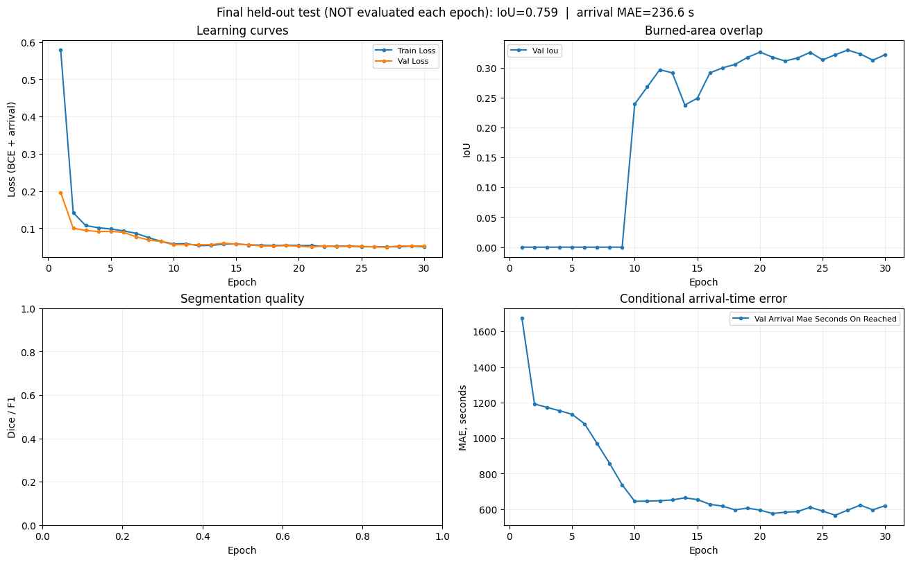

# Ember Observatory snapshot

Experiment: `arrival-pilot-20261114-02`

[HTML report](report.html) - [executed notebook](Ember_Observatory.executed.ipynb) - [metrics](metrics.json) - [provenance](metadata.json)

| Run | Epochs | Validation IoU | Test IoU | Conditional test arrival MAE (s) |
|---|---:|---:|---:|---:|
| outputs_baseline | 30 | 0.329381 | 0.758713 | 236.553 |
| outputs_initial | 30 | 0.320707 | 0.743433 | 234.776 |
| outputs_lower_lr | 30 | 0.269081 | 0.636407 | 232.620 |

Validation and test use different held-out regions. Conditional arrival error omits missed fire cells. This is a small simulator pilot, not operational wildfire accuracy.

