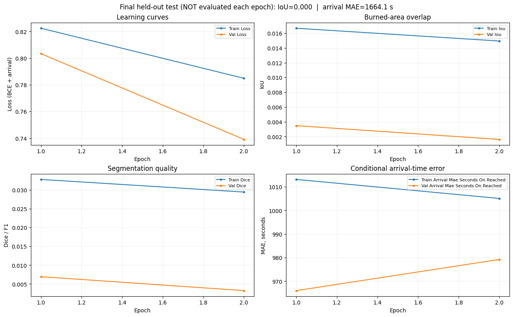
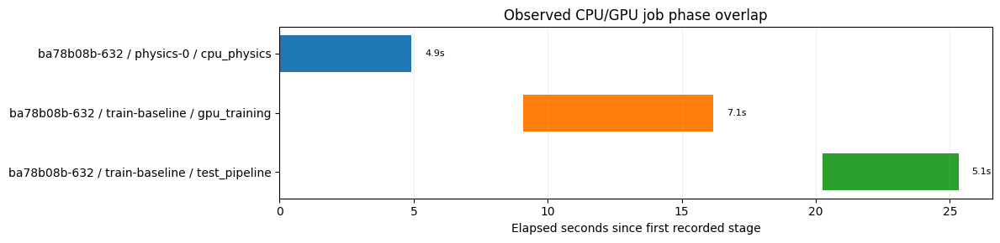
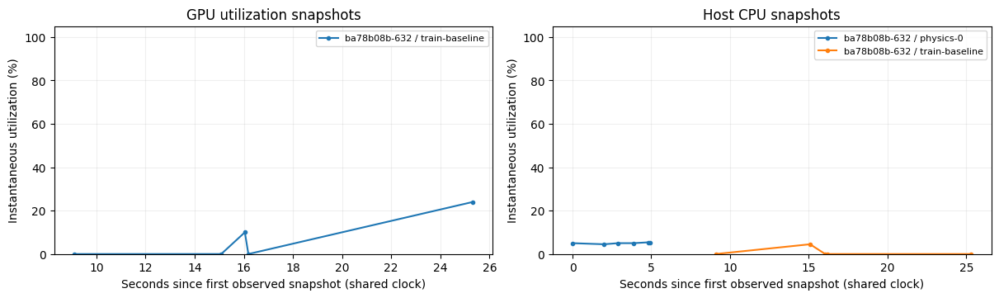
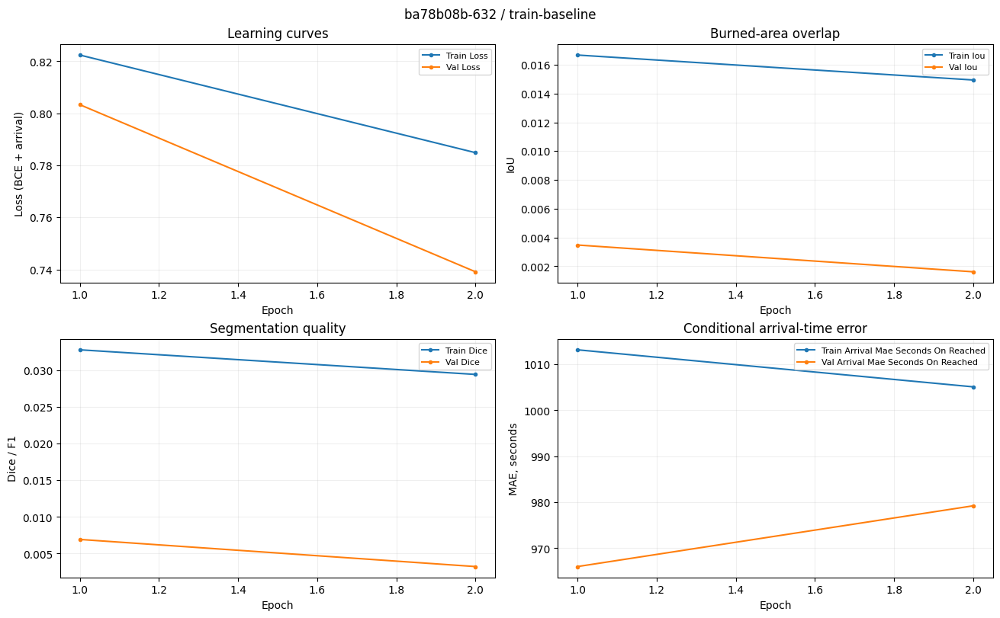
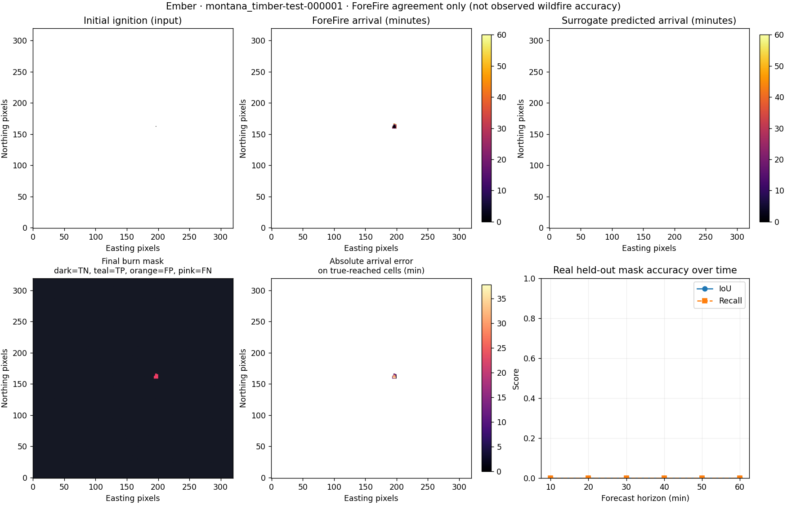
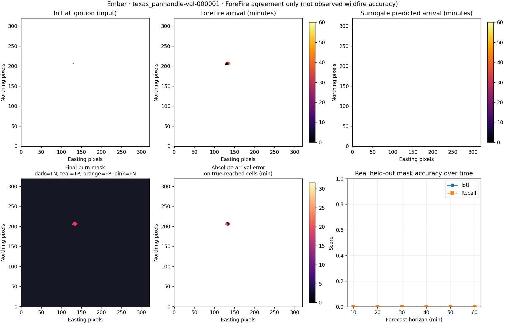
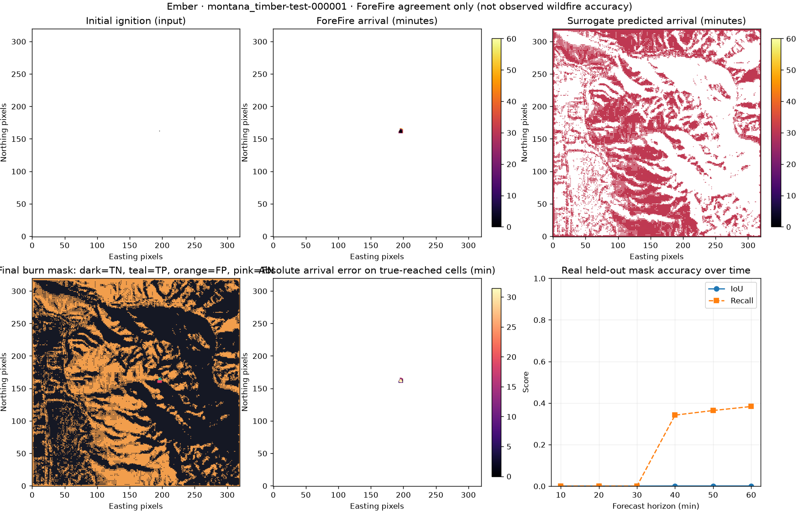
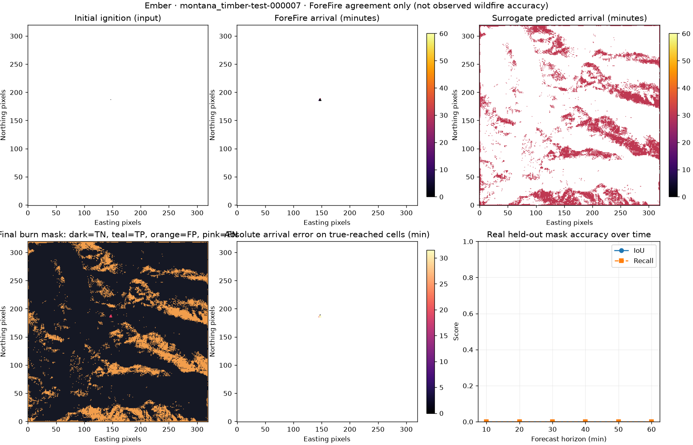

# Ember Observatory snapshot

Experiment: `obs-live-20261114T225205Z`

[HTML report](report.html) - [executed notebook](Ember_Observatory.executed.ipynb) - [metrics](metrics.json) - [provenance](metadata.json)

| Run | Epochs | Validation IoU | Test IoU | Conditional test arrival MAE (s) |
|---|---:|---:|---:|---:|
| outputs_baseline | 2 | 0.001616 | 0.000310 | 1664.097 |

Validation and test use different held-out regions. Conditional arrival error omits missed fire cells. This is a small simulator pilot, not operational wildfire accuracy.

